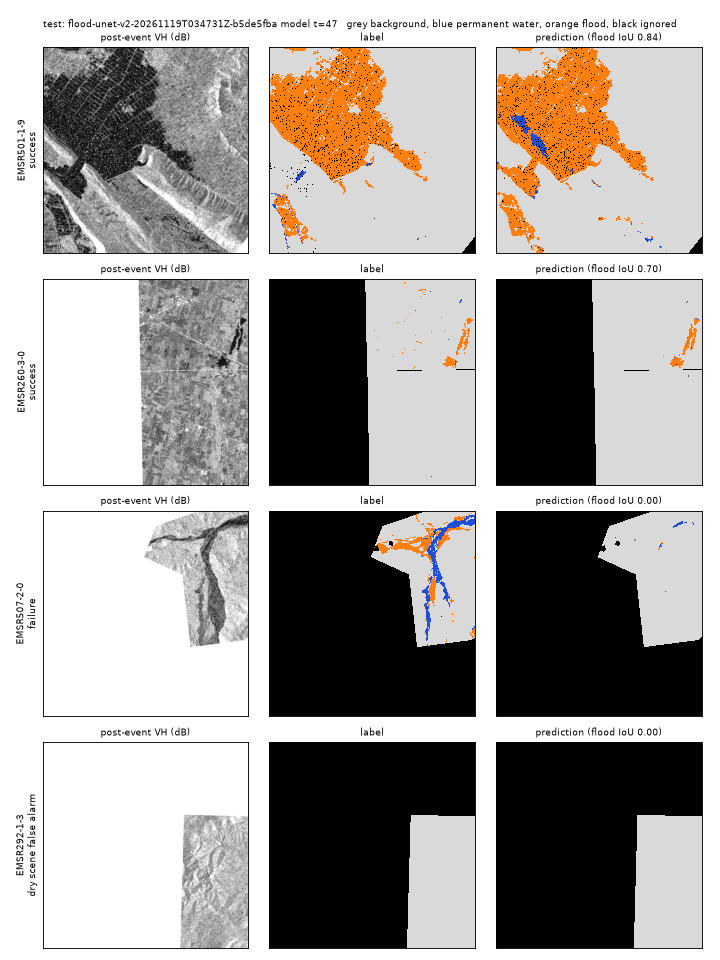
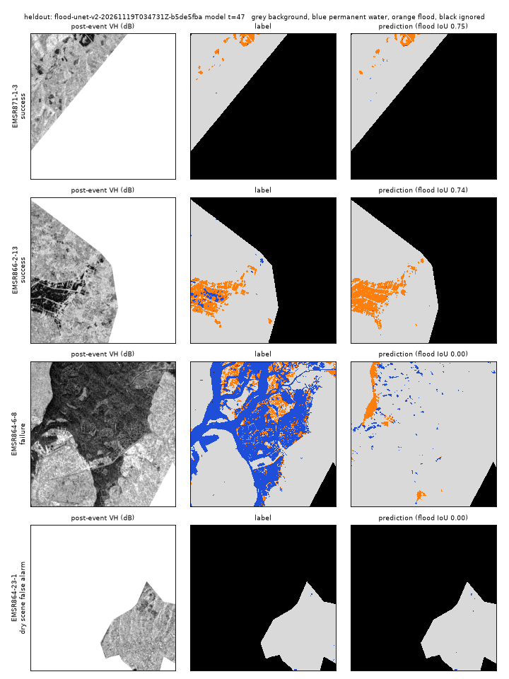

# Flood detection evaluation: `flood-unet-v2-20261119T034731Z-b5de5fba`

Generated 2026-11-19T05:28:45+00:00 from code `5dee4a4c00e369178f8a9ecfb1135f30b61f95f5`. Dataset GEOID-Flood v1.1, split version `fb68396f3ef4`.
Input: one post-event Sentinel-1 GRD image (VV, VH). Output: per-pixel background / permanent water / flooded water at the acquisition time. This is observed flood extent, not a forecast, and a historical evaluation does not establish live coverage.

## Selection on val (test not used)

Rule: maximize flood F2 (recall weighted 2x) on 150 val tiles from 38 events.

| candidate | decision | threshold | val F2 | val IoU | val precision | val recall |
|---|---|---|---|---|---|---|
| **flood-unet-v2-20261119T034731Z-b5de5fba** | model | 47/255 | 0.593 | 0.328 | 38.6% | 68.5% |
| flood-unet-v2-20261119T034731Z-b5de5fba | model_permwater | 59/255 | 0.565 | 0.310 | 37.2% | 65.0% |

Radar baseline tuned on val the same way: VH < -22.5 dB, outside the permanent-water reference.

## test: held-out events from the main tree (event + touching-area groups never seen in training or selection)

110 tiles, 47 events (44 with flood). Valid coverage 61.5%. Flooded tiles are over-represented in the selection, so pooled pixel metrics describe this sample, not natural flood prevalence. Accuracy is per labelled pixel and is dominated by background.

| method | recall | precision | flood IoU | Dice | F2 | accuracy (flood vs not) | accuracy (3 class) | dry-scene alarms | permanent water called flood | flood km² true / predicted |
|---|---|---|---|---|---|---|---|---|---|---|
| **selected U-Net** | 72.0% | 40.9% | 0.353 | 0.522 | 0.625 | 95.2% | 94.1% | 27/44 | 39.7% | 257.2 / 452.87 |
| VH < -22.5 dB + reference | 57.1% | 35.2% | 0.278 | 0.435 | 0.508 | 94.6% | 93.6% | 43/44 | 0.7% | 257.2 / 417.65 |
| never flood | 0.0% | n/a | 0.000 | 0.000 | 0.000 | 96.4% | 96.4% | 0/44 | 0.0% | 257.2 / 0.0 |

Dry-scene alarm: at least 0.05 km² mapped as flood on a tile with no labelled flood.

Per event (selected U-Net):

| event | tiles | flood IoU | flood px true | flood px predicted |
|---|---|---|---|---|
| EMSR166 | 2 | dry | 0 | 2599 |
| EMSR167 | 4 | 0.001 | 24629 | 68253 |
| EMSR192 | 4 | 0.251 | 74890 | 56073 |
| EMSR199 | 3 | 0.269 | 69617 | 201201 |
| EMSR258 | 3 | 0.116 | 17546 | 72275 |
| EMSR260 | 3 | 0.194 | 45622 | 28600 |
| EMSR267 | 3 | 0.316 | 228983 | 723877 |
| EMSR273 | 3 | 0.518 | 162703 | 218557 |
| EMSR275 | 3 | 0.530 | 192091 | 236715 |
| EMSR292 | 3 | 0.166 | 41192 | 108459 |
| EMSR333 | 2 | 0.350 | 26943 | 56240 |
| EMSR352 | 3 | 0.306 | 158648 | 502014 |
| EMSR358 | 3 | 0.345 | 39087 | 105935 |
| EMSR359 | 3 | 0.008 | 26840 | 4919 |
| EMSR411 | 3 | 0.363 | 34443 | 92230 |
| EMSR442 | 3 | 0.032 | 19670 | 201692 |
| EMSR467 | 3 | 0.013 | 15449 | 42662 |
| EMSR468 | 3 | 0.025 | 80669 | 31564 |
| EMSR486 | 1 | dry | 0 | 11608 |
| EMSR487 | 1 | 0.539 | 101696 | 61771 |
| EMSR497 | 2 | 0.381 | 102827 | 266773 |
| EMSR498 | 3 | 0.457 | 32570 | 39369 |
| EMSR501 | 3 | 0.784 | 308480 | 351619 |
| EMSR507 | 3 | 0.030 | 48871 | 5760 |
| EMSR517 | 3 | 0.277 | 23319 | 31567 |
| EMSR518 | 3 | 0.429 | 36154 | 63499 |
| EMSR520 | 1 | 0.335 | 41114 | 109265 |
| EMSR572 | 2 | 0.260 | 8514 | 11050 |
| EMSR659 | 2 | 0.003 | 25921 | 383 |
| EMSR663 | 1 | 0.606 | 217491 | 161648 |
| EMSR664 | 2 | 0.360 | 47982 | 44381 |
| EMSR665 | 2 | 0.020 | 29183 | 4965 |
| EMSR680 | 2 | 0.615 | 9631 | 8460 |
| EMSR722 | 1 | 0.417 | 13004 | 29627 |
| EMSR728 | 2 | 0.186 | 7701 | 38006 |
| EMSR755 | 2 | 0.071 | 6067 | 13394 |
| EMSR756 | 2 | 0.544 | 41047 | 62415 |
| EMSR762 | 2 | 0.509 | 61944 | 52572 |
| EMSR763 | 2 | 0.526 | 17114 | 31852 |
| EMSR766 | 2 | 0.103 | 2858 | 21233 |
| EMSR768 | 2 | 0.355 | 6288 | 4978 |
| EMSR770 | 1 | dry | 0 | 1782 |
| EMSR771 | 2 | 0.580 | 59415 | 86318 |
| EMSR797 | 2 | 0.302 | 9963 | 26159 |
| EMSR850 | 2 | 0.059 | 11915 | 175621 |
| EMSR854 | 2 | 0.516 | 7065 | 10439 |
| EMSR856 | 1 | 0.622 | 34881 | 48304 |

## heldout: GEOID-Flood held-out activations EMSR857-871 (Jan-Mar 2026), later than every training event; tiles overlapping main-tree ground removed

50 tiles, 7 events (7 with flood). Valid coverage 61.4%. Flooded tiles are over-represented in the selection, so pooled pixel metrics describe this sample, not natural flood prevalence. Accuracy is per labelled pixel and is dominated by background.

| method | recall | precision | flood IoU | Dice | F2 | accuracy (flood vs not) | accuracy (3 class) | dry-scene alarms | permanent water called flood | flood km² true / predicted |
|---|---|---|---|---|---|---|---|---|---|---|
| **selected U-Net** | 70.5% | 58.9% | 0.472 | 0.642 | 0.678 | 97.0% | 95.6% | 7/20 | 32.6% | 123.05 / 147.23 |
| VH < -22.5 dB + reference | 59.9% | 57.3% | 0.414 | 0.586 | 0.594 | 96.8% | 95.9% | 18/20 | 0.0% | 123.05 / 128.76 |
| never flood | 0.0% | n/a | 0.000 | 0.000 | 0.000 | 96.2% | 96.2% | 0/20 | 0.0% | 123.05 / 0.0 |

Dry-scene alarm: at least 0.05 km² mapped as flood on a tile with no labelled flood.

Per event (selected U-Net):

| event | tiles | flood IoU | flood px true | flood px predicted |
|---|---|---|---|---|
| EMSR857 | 9 | 0.503 | 205962 | 335503 |
| EMSR861 | 9 | 0.580 | 270670 | 382383 |
| EMSR864 | 8 | 0.362 | 218333 | 166189 |
| EMSR865 | 4 | 0.409 | 142920 | 214164 |
| EMSR866 | 7 | 0.492 | 143487 | 147804 |
| EMSR870 | 6 | 0.452 | 155048 | 147819 |
| EMSR871 | 7 | 0.406 | 94126 | 78390 |

## Limitations

- Single post-event image; no pre-event change detection.
- The decision threshold favours recall, so precision and dry-scene false alarms are the price; read them together.
- Labels are CEMS Rapid Mapping delineations. The source dataset is provisional pending the T2 decision.
- Scores are uncalibrated softmax outputs, not probabilities.
